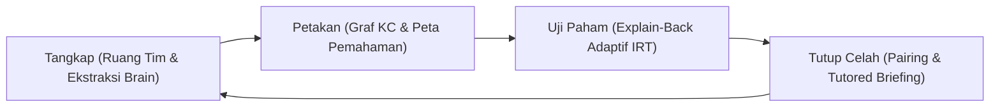
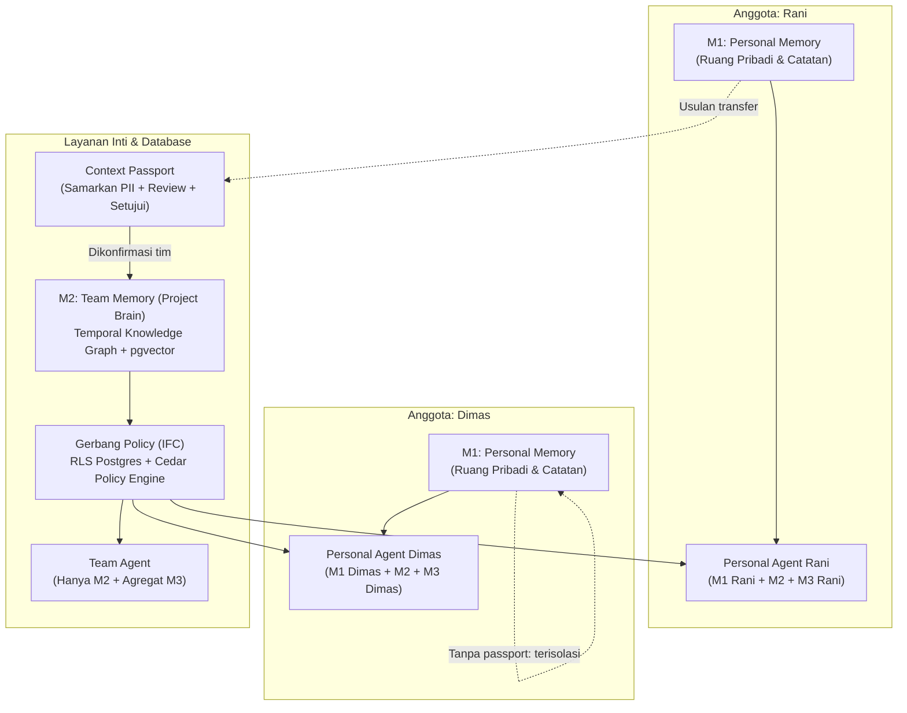
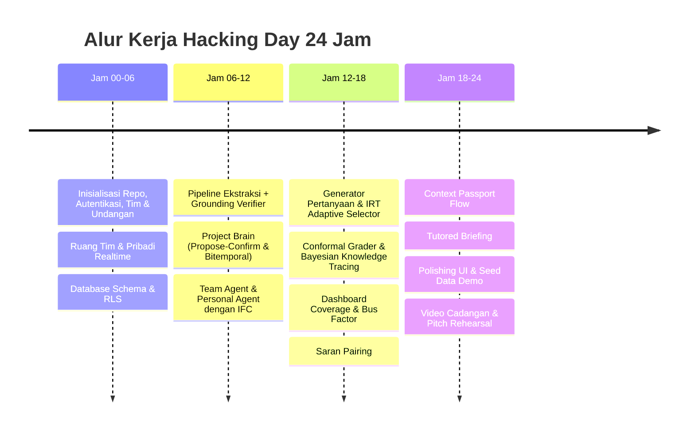

# BERSAMA — Dokumen Ide dan Arsitektur Teknis (v2)

> **Tagline:** *Satu tim, semua paham.*  
> **Kompetisi:** Hackvidia, Arkavidia 11.0 (HMIF ITB)  
> **Tema:** Human-Centered Engineering in the AI Era  
> **Subtema:** AI for Learning and Self-Growth  
> **Pernyataan Nilai untuk Juri:** *ChatGPT membantu tim tahu apa yang diputuskan. BERSAMA memastikan setiap anggota bisa menjelaskan kenapa.*

---

## 1. Ringkasan Eksekutif

**BERSAMA** adalah ruang kerja tim mahasiswa yang memastikan setiap anggota memahami esensi dan alasan di balik pekerjaan tim, bukan sekadar tahu apa yang telah diputuskan. 

Setiap anggota memiliki **AI agent pribadi** dengan memorinya sendiri. Agent ini mengetahui seluruh memori tim yang telah dikonfirmasi, ditambah konteks pribadi milik penggunanya tanpa pernah membocorkan konteks pribadi tersebut ke anggota lain. Di atas memori bersama tersebut, BERSAMA mengukur pemahaman tiap anggota melalui *explain-back check* singkat (3–5 menit/minggu), kemudian menutup celah pengetahuan melalui tutor interaktif (*Tutored Briefing*), sesi berbagi rekan (*Silo Alert & Pairing*), dan deteksi *knowledge silo*.

### Ringkasan Aspek Produk

| Aspek | Isi |
| :--- | :--- |
| **Pengguna Target** | Tim tugas kelompok & capstone (3–6 orang), dosen pengampu mata kuliah berbasis proyek |
| **Model Pembayaran** | Program studi (lisensi per mata kuliah untuk asesmen akuntabilitas individu/CPL OBE), tim software perusahaan |
| **Inti Teknologi AI** | Memori agen bertingkat dengan *Information-Flow Control* (IFC), *Temporal Knowledge Graph*, *Adaptive Explain-Back* berbasis Item Response Theory (IRT 2PL), LLM Grader dengan *Conformal Abstention*, *Bayesian Knowledge Tracing* (BKT) dengan forgetting, dan metrik *Knowledge Bus Factor* |
| **Prinsip Utama** | **AI mengusulkan, manusia memutuskan.** Skor pemahaman **tidak pernah** dijadikan komponen nilai akademis |

---

## 2. Latar Belakang Masalah & Landasan Ilmiah

### 2.1 Pembagian Kerja vs Kolaborasi Semu
Kerja kelompok di perguruan tinggi rentan terdegradasi menjadi pembagian kerja terisolasi (*silo*), memicu fenomena *free-rider*, satu orang memikul seluruh beban, atau tiap anggota hanya mengerti bagian kecil yang dikerjakannya (CMU Eberly Center).

### 2.2 Degradasi Kemampuan Akibat Ketergantungan AI
- **Bastani et al. (PNAS 2025):** RCT menunjukkan bahwa setelah akses GPT-4 tanpa *guardrail* dicabut, kemampuan siswa turun 17% dibandingkan kelompok kontrol yang tidak pernah memakai AI.
- **Anthropic (Januari 2026):** RCT pada 52 developer membuktikan skor kuis kelompok pemakai AI berada di kisaran 50% vs 67% pada kelompok manual, dengan defisit terbesar pada kemampuan *debugging* dan penelusuran akar masalah.

### 2.3 Keterbatasan Solusi Eksisting
Tools kolaborasi modern (ChatGPT Group Chats, ChatGPT Shared Projects, Gemini di Google Chat, Notion AI) hanya berfokus pada efisiensi "apa yang diputuskan" dan ekstraksi *action item*. Tidak ada tool yang memvalidasi apakah setiap anggota memahami alasan di balik keputusan teknis dan arsitektural.

### 2.4 Landasan Intervensi CSCL
Riset *Group Awareness Tools* pada *Computer-Supported Collaborative Learning* (CSCL) menunjukkan peningkatan signifikan pada *self-regulated learning* (meta-analisis dengan *effect size* $g = 0.61$, Frontiers in Psychology 2023).

---

## 3. Research Gap & Nilai Kebaruan (Novelty)

### 3.1 Celah yang Diisi BERSAMA
1. **Pengukuran Pemahaman Berkelanjutan:** Mengukur pemahaman per *Knowledge Component* (KC), memetakan *coverage*, dan mendeteksi *bus factor* tim.
2. **Berbagi Memori Pribadi Selektif (IFC):** Menegakkan batas privasi ketat antara memori individu dan memori tim melalui gerbang deterministik sebelum prompt masuk ke LLM.
3. **Group Awareness Adaptif Berbasis Keputusan Nyata:** Pertanyaan reflektif dibangkitkan langsung dari *decision record* tim, dioptimalkan secara adaptif, dan dinilai dengan jaminan risiko statistik (*conformal risk control*).

### 3.2 Empat Klaim Novelty

| Klaim | Keyakinan | Metode Verifikasi |
| :--- | :---: | :--- |
| **Explain-back adaptif dari log keputusan tim** | MODERATE | Scopus: `"group awareness" AND ("large language model" OR "generative AI") AND (collaborative OR team)` |
| **LLM grader dengan conformal selective prediction untuk penilaian formatif** | MODERATE | Scopus: `conformal AND ("short answer" OR grading) AND LLM` |
| **Memori multi-agent per anggota dengan label information-flow per item** | MODERATE | arXiv: `information flow control LLM agents memory multi-user` |
| **Bus factor pengetahuan untuk tim mahasiswa** | MODERATE | Scopus: `"truck factor" OR "bus factor" AND education` |

---

## 4. Konsep Solusi dan Fitur

Siklus mingguan BERSAMA: **Tangkap $\rightarrow$ Petakan $\rightarrow$ Uji Paham $\rightarrow$ Tutup Celah**.



### 4.1 Matriks Fitur

| # | Fitur | Deskripsi & Fungsi | Tahap |
| :--- | :--- | :--- | :---: |
| **F1** | **Ruang Tim** | Chat grup manusia + Team Agent. Team Agent menjawab hanya berdasarkan memori tim (M2). | **MVP** |
| **F2** | **Personal Agent per Anggota** | Agent pribadi yang mengetahui M2 + memori pribadi (M1) + skor pemahaman (M3) pemiliknya. Menjawab pertanyaan personal: *"Apa yang berubah dan berdampak ke tugasku?"* | **MVP** |
| **F3** | **Project Brain (Decision Record)** | Katalog keputusan bitemporal: opsi terpilih, alasan, alternatif yang ditolak, penanggung jawab, tenggat, dan pesan rujukan. Pola *propose-confirm*. | **MVP** |
| **F4** | **Context Passport** | Mekanisme berbagi ringkasan dari M1 ke M2 dengan masking PII otomatis dan pratinjau persetujuan pengguna. | **MVP** |
| **F5** | **Explain-back Check** | 3–5 pertanyaan/minggu ($\le 5$ menit). Prioritas pada KC yang tidak dikerjakan sendiri & item bertanda *"dibantu AI"*. Input via teks atau voice note. | **MVP** |
| **F6** | **Peta Pemahaman Tim** | Visualisasi *coverage* per KC, *knowledge bus factor*, dan indeks konsentrasi pengetahuan (Gini). | **MVP** |
| **F7** | **Silo Alert + Pairing** | Rekomendasi sesi peer 10 menit (*"Jelaskan ke aku"*) untuk pasangan anggota yang memaksimalkan peningkatan coverage submodular. | **MVP** |
| **F8** | **Tutored Briefing** | Onboarding anggota baru/terlambat melalui dialog Socratic interaktif berdasarkan riwayat keputusan di Brain. | **MVP** |
| **F9** | **Change-Impact Alert** | Notifikasi ke agent anggota jika keputusan yang memengaruhi modulnya mengalami perubahan. | Next |
| **F10** | **Conflict & Duplicate Detector** | Deteksi keputusan yang bertentangan atau tumpang tindih pengerjaan via Natural Language Inference (NLI). | Next |
| **F11** | **Jurnal Tumbuh** | Refleksi mandiri privat mengenai penguasaan konsep mingguan. | Next |
| **F12** | **Import Riwayat WhatsApp** | Parsing chat WA untuk bootstrapping Project Brain dan mengatasi *cold start*. | Next |
| **F13** | **Dashboard Dosen (Agregat)** | Monitoring agregat kesehatan tim, bus factor, dan coverage tanpa melihat skor individu. | Next |
| **F14** | **Integrasi LMS (LTI 1.3)** | Sinkronisasi kelas, kelompok, dan modul kuliah langsung dari LMS kampus. | Visi |

### 4.2 Batasan Etika Desain AI (Guardrails)
- **AI TIDAK BOLEH:**
  1. Mengambil keputusan akhir atas nama tim.
  2. Membagikan konteks pribadi tanpa persetujuan eksplisit pemilik.
  3. Memeringkat atau memberikan nilai akademis kepada mahasiswa.
  4. Mengirimkan data pemahaman individu kepada dosen.

---

## 5. Arsitektur Memori Bertingkat & Information-Flow Control (IFC)

Setiap anggota memiliki Personal Agent dengan ruang memori terisolasi. Memori bersama hanya dapat diakses melalui aturan deterministik sebelum LLM dipanggil.



### 5.1 Lima Tingkatan Memori (5 Tiers of Memory)

| Tier | Nama | Isi | Hak Baca | Penyimpanan |
| :---: | :--- | :--- | :--- | :--- |
| **M0** | **Working Context** | Konteks percakapan aktif | Sesi agen berjalan | Memori proses (in-memory / Redis) |
| **M1** | **Personal Memory** | Chat ruang pribadi, draft, catatan belajar, preferensi | Hanya pemilik & Personal Agent miliknya | PostgreSQL (enkripsi per baris/kolom) |
| **M2** | **Team Memory (Project Brain)** | *Temporal Knowledge Graph*: keputusan, argumen, alternatif, tugas, modul, KC | Seluruh anggota tim & Team Agent | PostgreSQL (tabel node & edge) + `pgvector` |
| **M3** | **Understanding Memory** | Probabilitas penguasaan $P(L)$ per (anggota, KC), riwayat attempt | Individu: pemilik saja.<br/>Agregat: tim & dosen | PostgreSQL |
| **M4** | **Audit Log** | Log mutasi memori, riwayat evaluasi policy, mitigasi serangan | Tim admin/auditor | PostgreSQL (*append-only*) |

### 5.2 Information-Flow Control (IFC) & Pertahanan Keamanan
- **Metadata Label:** Setiap entitas memiliki metadata: `owner_id`, `scope` (`private`, `team`, `course`), `sensitivity` (`normal`, `pii`), dan `provenance`.
- **Dua Lapis Penegakan:**
  1. *Database Layer:* PostgreSQL Row-Level Security (RLS).
  2. *Retrieval Service Layer:* Policy Engine deterministik (Cedar / OPA). LLM **tidak pernah** menerima konteks yang tidak lolos filter policy.
- **Taint Tracking:** Jawaban agen yang terkontaminasi M1 diberi label `tainted:private`. Jawaban ini diblokir untuk diposting ke ruang tim tanpa melalui alur *Context Passport*.
- **Pemisahan Instruksi dan Data (Prinsip CaMeL):** Seluruh input dari chat dan dokumen diperlakukan murni sebagai data pasif, bukan instruksi eksekutabel.

### 5.3 Pipeline Penulisan Memori Bitemporal
1. **Ekstraksi Kandidat:** LLM Structured Output (`JSON schema`) menghasilkan kandidat keputusan beserta alasan, alternatif, PIC, tenggat, dan referensi pesan sumber.
2. **Grounding Verification:** Verifier deterministik / model NLI memastikan setiap *field* didukung oleh bukti kutipan teks sumber.
3. **Deduplikasi & Resolusi Entitas:** Pencocokan kunci leksikal + *cosine similarity* embedding vektor.
4. **Deteksi Konflik:** Pengecekan kontradiksi semantik terhadap item terkonfirmasi pada KC yang sama.
5. **Propose-Confirm:** Masuk status `proposed` ke Ruang Tim; menunggu konfirmasi/edit anggota manusia.
6. **Pencatatan Bitemporal:** Dicatat dengan `valid_from` / `valid_to` (waktu berlaku secara substantif) dan `recorded_at` (waktu dicatat di sistem). Versi lama ditutup dengan relasi `supersedes`.
7. **Event Outbox:** Event dikirim ke *agent inbox* masing-masing anggota untuk pembaruan *delta digest*.

### 5.4 Hybrid Retrieval Pipeline
$$\text{Query} \longrightarrow \begin{cases} \text{Full-Text Search (Lexical BM25 via Postgres)} \\ \text{Dense Vector Search (Cosine Similarity via pgvector)} \end{cases} \longrightarrow \text{Reciprocal Rank Fusion (RRF)}$$
Dilanjutkan dengan: ekspansi graf 1-hop (`depends_on`, `about_kc`) $\rightarrow$ filter temporal *as-of* $\rightarrow$ *reranking* $\rightarrow$ *context packing* dengan sitasi transparan ke pesan asli.

---

## 6. Desain AI & Formulasi Metode Statistik

Tidak ada LLM yang dilatih dari awal (*no pretraining from scratch*). Keunggulan teknis BERSAMA terletak pada pembungkusan LLM pihak ketiga dengan model statistik bermatematika kuat.

### 6.1 Pemilihan Pertanyaan Adaptif (Item Response Theory 2PL)
Kemampuan anggota pada topik dinotasikan dengan $\theta$. Probabilitas anggota menjawab benar soal $j$ dengan parameter diskriminasi $a_j$ dan tingkat kesulitan $b_j$:

$$P_j(\theta) = \frac{1}{1 + e^{-a_j(\theta - b_j)}}$$

Informasi Fisher untuk item $j$:

$$I_j(\theta) = a_j^2 \, P_j(\theta) \, \bigl(1 - P_j(\theta)\bigr)$$

Pertanyaan berikutnya dipilih untuk memaksimalkan fungsi utilitas:

$$j^* = \arg\max_j \left[ I_j(\hat{\theta}) \times w_j \right]$$

*Bobot Prioritas ($w_j$):*
- Faktor pengali tinggi jika KC **tidak dikerjakan sendiri** oleh anggota.
- Faktor pengali tinggi jika keputusan terkait bertanda **"dibantu AI"**.
- Faktor pengali tinggi jika KC berada pada posisi sentralitas dependensi tinggi dalam graf.

### 6.2 LLM Grader dengan Conformal Abstention
Evaluasi jawaban esai singkat dinilai oleh LLM menggunakan rubrik terstruktur dengan *self-consistency* sebanyak $k$ kali cuplikan. Skor ketidakpastian $s$ didefinisikan sebagai proporsi ketidaksepakatan terhadap modus.

Dengan *Conformal Risk Control* (Angelopoulos et al., ICLR 2024), ambang batas ketidakpastian $\hat{\lambda}$ dikalibrasi sehingga tingkat kesalahan yang diterima dibatasi pada batas toleransi $\alpha$:

$$\mathbb{E}\left[\, \mathbf{1}\{\text{grade salah}\} \cdot \mathbf{1}\{s \le \hat{\lambda}\} \,\right] \le \alpha$$

> **Mekanisme Abstain:** Jika $s > \hat{\lambda}$, sistem menolak menilai secara otomatis (*abstain*). Pertanyaan dialihkan ke pembuat keputusan/rekan tim terkait untuk dijelaskan langsung dalam format *peer learning*.

### 6.3 Pelacakan Pemahaman (Bayesian Knowledge Tracing dengan Forgetting)
Tingkat penguasaan konsep diperbarui secara probabilistik:

$$P(L_{t+1}) = P(L_t \mid \text{obs})(1 - p_F) + \bigl(1 - P(L_t \mid \text{obs})\bigr) \, p_T$$

- $p_T$: Peluang transisi belajar (*learning rate*).
- $p_F$: Peluang lupa (*forgetting rate*).
- Parameter standar *guess* ($p_G$) dan *slip* ($p_S$).
- **Integritas Bukti:** Hanya jawaban mandiri pada *Explain-Back Check* yang dapat memperbarui $P(L)$. Aktivitas tugas yang dibantu AI hanya dicatat sebagai paparan (*exposure*).

### 6.4 Metrik Tim & Formulasi Bus Factor
- **Coverage KC ($k$):** Jumlah anggota dengan probabilitas pemahaman $P(L) \ge \tau$ (ambang batas penguasaan).
- **Knowledge Bus Factor:** Jumlah anggota minimum terkecil yang jika meninggalkan tim akan menyebabkan $\ge 50\%$ KC kritis kehilangan representasi anggota yang memahaminya (diadaptasi dari Avelino et al., ICPC 2016).
- **Konsentrasi Pengetahuan:** Koefisien Gini dihitung atas distribusi nilai $P(L)$ anggota per KC.
- **Optimizer Pairing:** Pemilihan pasangan belajar (*pairing*) diselesaikan secara *greedy* pada fungsi objektif *submodular coverage*.

---

## 7. Arsitektur Sistem & Tech Stack

Sistem dibangun dengan arsitektur **Modular Monolith** terhubung ke **Asynchronous AI Worker**.

```
+-----------------------------------------------------------------+
|                   Next.js Web Client (React + Tailwind)         |
|         Ruang Tim | Ruang Pribadi | Project Brain | Dashboard   |
+-------------------------------+---------------------------------+
                                |
       +------------------------+------------------------+
       | REST / WebSocket                                | Supabase SDK
       v                                                 v
+-------------------------------+       +---------------------------------+
|   Layanan AI (FastAPI)        |       |   Supabase Platform             |
|   Agent Orchestrator          |<----->|   - Postgres DB + RLS (IFC L1)  |
|   Retrieval + Citations       |       |   - Auth & Realtime             |
+---------------+---------------+       |   - Audit Log (Append-only)     |
                |                       +---------------------------------+
                v
+-------------------------------+
|   Cedar Policy Engine         |
|   IFC Lapis 2                 |
+-------------------------------+
                |
                v
+-------------------------------+
|   Worker AI (Job Queue)       |
|   - Ekstraksi + Verifier      |
|   - Conformal Grader          |
|   - IRT & BKT Engine          |
+---------------+---------------+
                |
                v
+-------------------------------+
|   LLM Gateway & Observability |
|   - Fallback Router & Cache   |
|   - OpenTelemetry & Langfuse  |
+-------------------------------+
```

### 7.1 Komponen Teknologi

| Lapisan | Pilihan Teknologi | Justifikasi Teknis |
| :--- | :--- | :--- |
| **Frontend** | **Next.js (App Router, React) + Tailwind CSS** | Cepat, responsif mobile, ekosistem kaya, rendering optimal |
| **Auth & Database** | **Supabase (PostgreSQL + RLS + Realtime)** | Row-Level Security menjadi penegak lapis pertama IFC |
| **Vektor & Pencarian** | **`pgvector` + PostgreSQL Full-Text Search** | Hybrid retrieval dalam satu *database instance* tanpa perlu vector DB terpisah |
| **Layanan AI** | **FastAPI (Python 3.11+)** | Integrasi native pustaka data science, performa asinkron tinggi |
| **Policy Engine** | **Cedar / Open Policy Agent (OPA)** | Evaluasi izin akses deterministik M1/M2/M3 sebelum prompt dibuat |
| **Background Queue** | **Celery / Redis / ARQ** | Menjaga latensi chat tetap rendah; ekstraksi & grading berjalan di latar |
| **LLM Gateway** | **LiteLLM / Custom Router** | Fallback otomatis multi-provider, *caching*, *rate limiting*, kuota token |
| **Observability** | **Langfuse + OpenTelemetry** | Tracing prompt, evaluasi latensi, token cost, dan logging metrik AI |
| **Deployment** | **Vercel (Frontend) + GCP Cloud Run (FastAPI Backend)** | Serverless, *auto-scaling*, efisien biaya untuk kompetisi |

### 7.2 Skema Data Inti (Database Schema)

- `users (id, email, name, role, created_at)`
- `teams (id, name, created_at)`
- `memberships (user_id, team_id, role)` *(member, lead, lecturer)*
- `messages (id, team_id, room, author_id, body, created_at)` *(room: 'team' | 'private')*
- `memory_items (id, team_id, type, content_json, owner_id, scope, sensitivity, status, valid_from, valid_to, recorded_at, source_message_ids)` *(type: decision, task, rationale, note; status: proposed, confirmed, superseded)*
- `memory_edges (src_id, dst_id, kind)` *(kind: supersedes, depends_on, about_kc, owned_by, conflicts_with)*
- `knowledge_components (id, team_id, name, criticality)`
- `questions (id, kc_id, item_id, bloom_level, irt_a, irt_b, rubric_json)`
- `check_attempts (id, user_id, question_id, answer, grade, uncertainty, abstained, graded_by)`
- `mastery (user_id, kc_id, p_mastery, last_evidence_at)`
- `embeddings (item_id, vector)`
- `agent_inbox (id, user_id, event_id, relevance_score, delivered)`
- `audit_log (id, actor_id, action, target_id, policy_decision, timestamp)`

### 7.3 Spesifikasi Endpoint API Utama

```http
POST /teams/{id}/messages          # Kirim pesan (memicu job ekstraksi)
GET  /teams/{id}/brain?as_of=      # Baca Project Brain pada titik waktu tertentu
POST /memory/{id}/confirm          # Konfirmasi atau revisi usulan memori
POST /passport/preview             # Pratinjau sanitasi M1 -> M2 (PII masking)
POST /passport/share               # Eksekusi migrasi M1 -> M2
POST /agents/me/ask                # Tanya Personal Agent (konteks M1 + M2 + M3 sendiri)
POST /agents/team/ask              # Tanya Team Agent (konteks M2 + agregat M3)
GET  /checks/next                  # Ambil soal Explain-back adaptif berikutnya
POST /checks/{id}/answer           # Kirim jawaban (memicu conformal grader & BKT)
GET  /teams/{id}/understanding     # Ambil metrik coverage, bus factor, saran pairing
GET  /me/digest                    # Ambil rangkuman pembaruan personal (delta digest)
```

---

## 8. Privasi, Kepatuhan Hukum, dan Etika

### 8.1 Matriks Visibilitas Data

| Data Entitas | Anggota Pemilik | Anggota Lain | Dosen |
| :--- | :---: | :---: | :---: |
| Isi Ruang Pribadi & Memori M1 | **Ya** | **Tidak** | **Tidak** |
| Item yang dibagikan via Context Passport | **Ya** | **Ya** | **Tidak** |
| Skor pemahaman individu ($P(L)$) | **Ya** | **Tidak** | **Tidak** |
| Status kepemilikan kompetensi (*"Siapa yang paham KC ini"*) | **Ya** | **Ya** *(framing positif)* | **Tidak** |
| Metrik agregat (*Coverage, Bus Factor, Gini*) | **Ya** | **Ya** | **Ya** *(agregat tim)* |

### 8.2 Kepatuhan UU No. 27 Tahun 2022 (UU PDP)
- *Explicit Consent:* Persetujuan saat pendaftaran terpisah untuk *explain-back* dan pemrosesan suara.
- *Data Minimization:* Hanya data yang lolos evaluasi policy yang dikirim ke LLM API.
- *Right to Erasure:* Penghapusan akun melenyapkan pesan privat M1, embeddings, dan histori individual.
- *Data Retention:* Data proyek dihapus otomatis 6 bulan setelah semester berakhir.

---

## 9. Rencana Validasi & Evaluasi

### 9.1 Uji 1 Jam (Empirical Baseline)
- Menguji 5 tim mahasiswa yang baru menyelesaikan proyek bersama.
- Mengambil 5 keputusan arsitektur/teknis utama per tim.
- Menguji setiap anggota mengenai keputusan yang **bukan dibuat oleh dirinya**.
- Menghitung rasio keputusan yang dapat dijelaskan dan tingkat ketergantungan silo.

### 9.2 Target Metrik Komponen AI

| Komponen | Data Uji | Metrik | Ambang Batas Target |
| :--- | :--- | :--- | :---: |
| **Ekstraksi Decision Record** | 200 pesan chat tim beranotasi | F1-Score | $\ge 0.75$ |
| **Verifier Grounding** | Kandidat field dengan data sintetis palsu | Recall field palsu | $\ge 0.90$ |
| **Deteksi PII** | 100 pesan bersintetis PII Indonesia | Recall | $\ge 0.95$ |
| **Conformal Grader** | Jawaban Uji 1 Jam vs 2 Penilai Manusia | QWK ($\alpha = 0.1$) | $\text{QWK} \ge 0.60$ |
| **Information-Flow Control** | 30 skenario serangan prompt injection & leak | Kasus kebocoran M1 | **0 kasus (Zero Leak)** |
| **Delta Digest** | Log notifikasi relevansi pilot | Precision@3 | $\ge 0.60$ |

---

## 10. Model Bisnis & Keberlanjutan

- **Model B2B Kampus (B2Inst):** Lisensi per mata kuliah/semester dibayar oleh program studi untuk pemenuhan bukti asesmen akuntabilitas individu pada akreditasi berbasis luaran (*Outcome-Based Education* / OBE).
- **Struktur Biaya:**
  $$C_{\text{tim/bulan}} = N_{\text{panggilan}} \times \bar{T} \times p_{\text{token}} + C_{\text{embedding}} + C_{\text{storage}} + C_{\text{ASR}}$$
  Efisiensi dicapai melalui ekstraksi batch, *prompt caching*, penggunaan model kecil-cepat (misal Gemini Flash / GPT-4o-mini), dan pembatasan kuota per tim.
- **Competitive Moat:** Akumulasi data kalibrasi grader dan parameter kesulitan IRT spesifik untuk silabus mata kuliah komputasi.

---

## 11. Roadmap Eksekusi & Rencana Hacking Day 24 Jam

### Target Pengumpulan Berkas (6 Desember 2026, 23.59 WIB)
- Proposal lengkap (maks. 10 halaman)
- Lean Canvas
- Wireframe antarmuka
- Video demonstrasi alur konsep (maks. 5 menit)

### Jadwal 24-Jam Hacking Day (29–31 Januari 2027)



---

## 12. Daftar Referensi Utama

1. Bastani, H. et al. (2025). *Generative AI without guardrails can harm learning*. PNAS, 122.
2. Shen, J. & Tamkin, A. (2026). *How AI assistance impacts the formation of coding skills*. Anthropic Research.
3. CMU Eberly Center. *Challenges of group projects and assessing individual contributions*.
4. Chen, D. et al. (2024). *Effects of group awareness support in CSCL on students' learning performance: A three-level meta-analysis*. IJCSCL, 19(1), 97–129.
5. Angelopoulos, A. N. et al. (2024). *Conformal risk control*. ICLR 2024.
6. Avelino, G. et al. (2016). *A novel approach for estimating truck factors*. ICPC 2016.
7. Corbett, A. T. & Anderson, J. R. (1994). *Knowledge tracing*. UMUAI, 4.
8. Debenedetti, E. et al. (2025). *Defeating prompt injections by design (CaMeL)*. arXiv.
9. Rasmussen, P. et al. (2025). *Zep: A temporal knowledge graph architecture for agent memory*. arXiv.
10. Lord, F. M. (1980). *Applications of item response theory to practical testing problems*.
